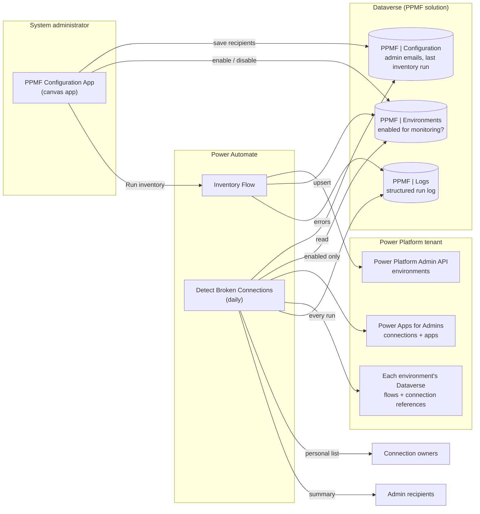

<p align="center">
  
</p>

<h1 align="center">Power Platform Monitoring Framework (PPMF)</h1>

<p align="center">
  Proactive, low-code monitoring for Microsoft Power Platform.<br>
  Find broken connections <b>and the apps and flows they break</b> across every environment,
  tell the right people, and log everything in one place.
</p>

<p align="center">
  
  
  
</p>

---

## Why PPMF exists

When a connection in Power Platform breaks (an expired password, revoked consent,
a deleted account, a changed MFA policy), the apps and flows that use it fail **quietly**.
Makers usually find out from users, often days later. Administrators can see a list of
connections, but the platform does not answer the question that matters during an incident:

> *"Which connections are broken right now, in which environments, who owns them,
> and which apps and flows will fail because of them?"*

PPMF answers that question automatically, every day, across all monitored environments,
and sends each owner a list of exactly what they need to fix. It is built entirely from
Power Platform's own building blocks (Dataverse, Power Automate, Power Apps), so any
organization can install it as a single solution, with no servers or custom code to host.

## What it does today

| Capability | Status | Component |
|---|---|---|
| Daily scan of all enabled environments for broken connections | Available | `PPMF \| Connections \| Detect Broken Connections` |
| Map each broken connection to the **flows** that use it (directly or through connection references) | Available | same flow |
| Map each broken connection to the **canvas apps** most likely affected (same connector and owner) | Available | same flow |
| Email every connection owner their own list, with steps to fix it | Available | same flow |
| Admin summary email with a table of every finding | Available | same flow |
| Centralized, structured logging with error details and run links | Available | `PPMF \| Logs` table |
| Environment inventory (discovers environments, keeps admin choices) | Available | `PPMF \| Inventory Flow` |
| Admin configuration app (alert recipients, run inventory, enable/disable environments) | Available | `PPMF - Configuration App` |
| Expiring app-registration secrets and certificates | Roadmap | `Application Users \| Monitor Credential Expiration` |
| Expiring service-account passwords | Roadmap | `Service Accounts \| Monitor Password Expiration` |
| Production flow run failures | Roadmap | `Flows \| Monitor Production Failures` |
| Solution deletion alerts | Roadmap | `Solutions \| Monitor Deletion Events` |

The roadmap flows ship in the solution as placeholders so the structure is in place.
See [docs/roadmap.md](docs/roadmap.md).

## How it works



A deeper walkthrough, with sequence and data-model diagrams, is in
[docs/architecture.md](docs/architecture.md).

## Quick start

1. **Install:** import `solution/PPMF_1_0_1_0_managed.zip` into a monitoring environment
   and connect the three connection references when prompted (Dataverse, Power Apps for Admins,
   Office 365 Outlook). → [docs/installation.md](docs/installation.md)
2. **Configure:** open **PPMF - Configuration App**, enter the admin email addresses,
   and click **Run inventory now**. → [docs/configuration.md](docs/configuration.md)
3. **Choose environments:** switch on the environments you want monitored.
4. **Done.** The scan runs daily. Results arrive by email and are written to **PPMF | Logs**.

> PPMF needs a Power Platform administrator (or Dynamics 365 administrator) account
> for the admin connectors. See [Permissions](docs/installation.md#permissions).

## Documentation

| Guide | What's in it |
|---|---|
| [Architecture](docs/architecture.md) | Components, data flow, sequence diagrams and the design decisions behind them |
| [Installation](docs/installation.md) | Prerequisites, permissions, import steps, connection references |
| [Configuration](docs/configuration.md) | Using the configuration app; schedules and recipients |
| [Data model](docs/data-model.md) | Every table and column |
| [Flows](docs/flows.md) | Each flow's trigger, logic and error handling |
| [Logging](docs/logging.md) | Log levels, fields, and useful queries |
| [Troubleshooting](docs/troubleshooting.md) | Known issues and fixes |
| [Design rationale](docs/design-rationale.md) | What is new in PPMF and how it compares with existing tools |
| [Roadmap](docs/roadmap.md) | Planned monitors |

## Repository layout

```
PPMF/
├── solution/                 Exported solution packages (managed + unmanaged)
├── src/                      Unpacked unmanaged solution (readable source)
├── docs/                     Documentation and diagrams
├── power-apps/theme/         Reusable Power Apps theme (BrandTheme)
├── brand/                    Icons, favicon, social preview, colors
├── CHANGELOG.md
├── CITATION.cff
└── LICENSE
```

## Contributing

Issues and pull requests are welcome. See [CONTRIBUTING.md](CONTRIBUTING.md).

## Citing PPMF

If you use or build on PPMF in research, a talk or a publication, please cite it.
GitHub shows a **"Cite this repository"** button generated from [CITATION.cff](CITATION.cff).

## License

[MIT](LICENSE) © Manjunath Gundala
