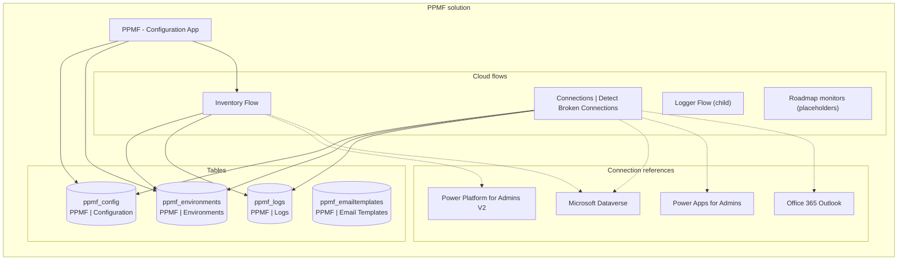
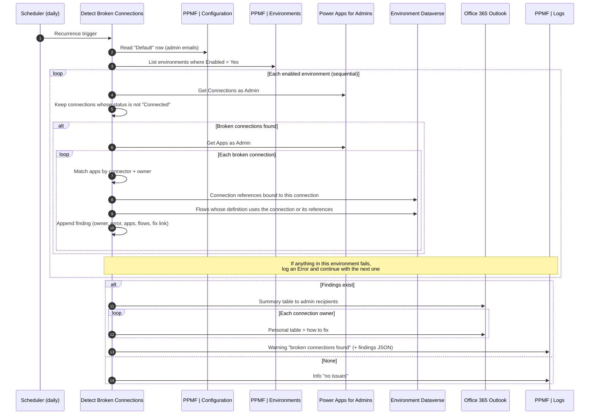
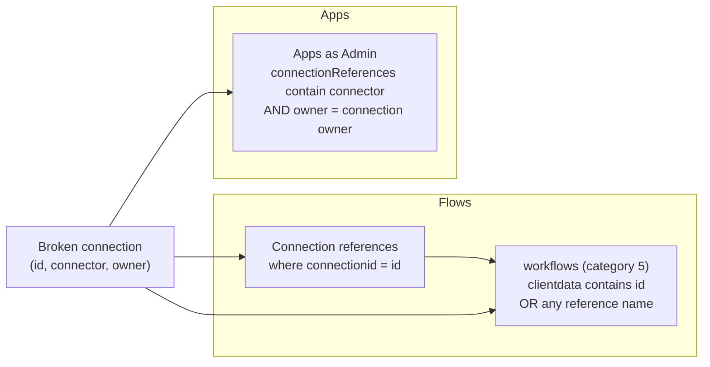
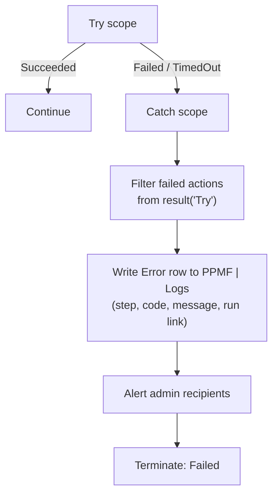
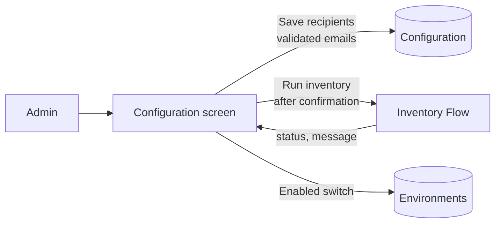

# Architecture

PPMF is a single Dataverse solution (`PPMF`, publisher prefix `ppmf_`) made of three
tables, cloud flows, one canvas app, and connection references. Nothing runs outside
Power Platform.

## Components

| Component | Type | Purpose |
|---|---|---|
| `PPMF \| Configuration` | Table | Framework settings (admin email recipients, last inventory run). One row named `Default`. |
| `PPMF \| Environments` | Table | One row per environment, with an **Enabled** switch that controls monitoring. |
| `PPMF \| Logs` | Table | Structured log of every run, warning and error. |
| `PPMF \| Email Templates` | Table | Reusable email subjects and bodies (reserved for future monitors). |
| `PPMF \| Inventory Flow` | Instant flow (Power Apps trigger) | Discovers environments and upserts them into **Environments**. |
| `PPMF \| Connections \| Detect Broken Connections` | Scheduled flow (daily) | Finds broken connections, maps their impact, notifies owners and admins, logs results. |
| `PPMF - Configuration App` | Canvas app | Admin UI for settings, inventory and environment selection. |

## End-to-end: detecting broken connections

### How impact is determined

Finding *which* apps and flows a broken connection affects is the core of PPMF.
Power Platform stores this relationship differently for flows and apps, so PPMF uses
two strategies:

- **Flows (exact match).** Cloud flows store their connections in the `clientdata`
  definition of the Dataverse `workflow` row. Non-solution flows embed the connection
  name. Solution flows embed a connection-reference logical name, which PPMF resolves
  through the `connectionreference` table. Each flow is listed with its On/Off state.
- **Canvas apps (likely match).** App metadata records the connectors an app uses, not
  which user's connection it uses at run time. PPMF reports apps that use the same
  connector **and** are owned by the connection's owner. The emails say this is a
  "likely affected" list.

## Error-handling model

Every flow follows the same Try / Catch / Log pattern:

- **Per-environment isolation.** The environment loop has its own Try/Catch. One
  environment failing (permissions, region outage) logs an error and the scan continues.
- **Soft failures are warnings.** A failed app lookup, flow lookup or single owner email
  writes a Warning row; the rest of the run continues.
- **Bounded log fields.** Every value written to the Logs table is truncated to the column
  size (500 characters), so logging itself cannot fail on long error text.
- **Traceability.** Each log row carries the run ID, flow ID and a deep link to the run.

## Configuration app

The app uses a single global theme record (`BrandTheme`, set in `App.OnStart`) in
Texas-flag colors. See [power-apps/theme](../power-apps/theme).

## Security model

- Flows run as the **flow owner's** connections (connection references). The owner needs
  Power Platform administrator rights to list connections and apps in every environment,
  and read access to each environment's Dataverse to resolve flows.
- Owners only receive their **own** connections; admins receive the full summary.
- No credentials, tokens or secrets are stored in PPMF tables.
