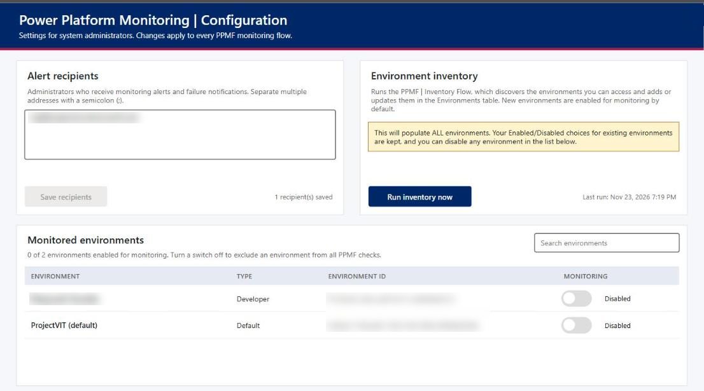

# Configuration

All settings are managed in **PPMF - Configuration App**, a canvas app for system
administrators. Settings are stored as data in the **PPMF | Configuration** table, so they
survive solution upgrades.

## Alert recipients

Administrators who receive the daily summary and failure alerts.

1. Enter one or more email addresses, separated by semicolons (`;`).
2. Any invalid address is shown in red under the box and **Save** stays disabled.
3. Click **Save recipients**. Addresses are trimmed, lowercased and stored as
   `a@contoso.com;b@contoso.com` in `ppmf_adminemails`.

The monitoring flows read this value at the start of every run. No flow changes are needed.

## Environment inventory

**Run inventory now** starts `PPMF | Inventory Flow`, which:

- lists every environment the flow owner can access,
- **adds** environments that aren't in the table yet, with **Enabled = Yes**,
- **updates** the name, type and URL of existing environments, and
- **never changes** an existing environment's Enabled/Disabled choice.

You'll be asked to confirm first, because the inventory populates **all** environments.
When it finishes, the app shows the result and updates **Last run**.

Run the inventory whenever environments are created, renamed or deleted.

## Choosing which environments are monitored

The **Monitored environments** list shows every environment with a switch:

| Switch | Effect |
|---|---|
| **Enabled** | Included in every PPMF scan |
| **Disabled** | Skipped by every PPMF scan; it stays in the list so the choice is remembered |

Typical choices: disable personal developer environments and trial environments;
keep production and shared environments enabled.

Use the search box to filter by name or environment ID.

## Schedules

| Flow | Default schedule | Change it |
|---|---|---|
| Detect Broken Connections | Daily at 16:00 UTC | Edit the flow's **Recurrence** trigger |

## Email content

Owner emails contain only that owner's connections, with:

- environment, connection name, connector, status and error message,
- apps likely affected and flows affected (with On/Off state),
- a **Fix here** link to the environment's Connections page, and
- step-by-step instructions to re-authenticate.

The admin summary contains every finding plus the number of environments that could not
be scanned.

## Theme

The app's look comes from a single record, `BrandTheme`, set in `App.OnStart`.
To restyle the app, edit the colors there. See [power-apps/theme](../power-apps/theme).
