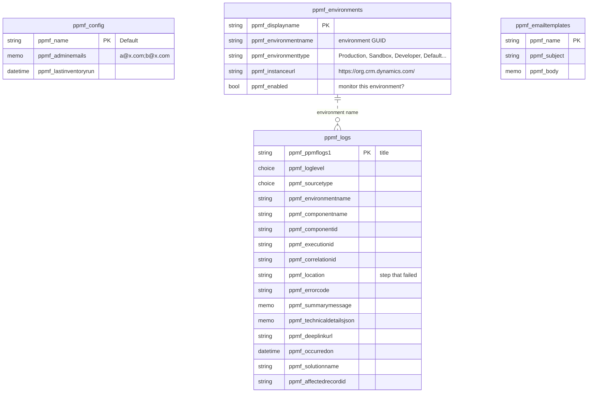

# Data model

All tables use the publisher prefix `ppmf_` and are user-owned.

## PPMF | Configuration (`ppmf_config`)

One row, named `Default`. New settings are added as new columns.

| Column | Logical name | Type | Notes |
|---|---|---|---|
| Name | `ppmf_name` | Text (100) | Primary column. Always `Default`. |
| Admin Emails | `ppmf_adminemails` | Multiline text (4,000) | Semicolon-separated recipients for summaries and failure alerts |
| Last Inventory Run | `ppmf_lastinventoryrun` | Date and time | Set by the configuration app after a successful inventory |

## PPMF | Environments (`ppmf_environments`)

| Column | Logical name | Type | Notes |
|---|---|---|---|
| Display Name | `ppmf_displayname` | Text | Primary column |
| Environment Name | `ppmf_environmentname` | Text | Environment ID (GUID, or `Default-<tenant>`) |
| Environment Type | `ppmf_environmenttype` | Text | Production, Sandbox, Developer, Default, Trial |
| Instance Url | `ppmf_instanceurl` | Text | Dataverse URL; needed to resolve flows |
| Enabled | `ppmf_enabled` | Yes/No (default **Yes**) | Monitors skip environments set to No |

## PPMF | Logs (`ppmf_logs`)

All text columns hold up to 500 characters; flows truncate values to fit.

| Column | Logical name | Notes |
|---|---|---|
| Title | `ppmf_ppmflogs1` | e.g. `Detect Broken Connections - environment failed` |
| Log Level | `ppmf_loglevel` | Info, Warning, Error, Critical, Audit |
| Source Type | `ppmf_sourcetype` | Canvas App, Model-Driven App, Cloud Flow, Dataflow, Custom API, Solution |
| Summary Message | `ppmf_summarymessage` | Human-readable summary |
| Technical Details | `ppmf_technicaldetailsjson` | Failed-action JSON or findings (truncated) |
| Location | `ppmf_location` | Action or scope where it happened |
| Error Code | `ppmf_errorcode` | Connector or PPMF error code |
| Environment Name | `ppmf_environmentname` | Environment display name, or `All` |
| Component Name / ID | `ppmf_componentname`, `ppmf_componentid` | Flow display name and ID |
| Execution ID | `ppmf_executionid` | Flow run ID |
| Correlation ID | `ppmf_correlationid` | Client tracking ID |
| Deep Link URL | `ppmf_deeplinkurl` | Link to the flow run |
| Occurred On | `ppmf_occurredon` | UTC timestamp |
| Solution Name | `ppmf_solutionname` | `Power Platform Monitoring Framework` |

### Choice values

| Log Level | Value | | Source Type | Value |
|---|---|---|---|---|
| Info | 426170000 | | Canvas App | 426170000 |
| Warning | 426170001 | | Model-Driven App | 426170001 |
| Error | 426170002 | | Cloud Flow | 426170002 |
| Critical | 426170003 | | Dataflow | 426170003 |
| Audit | 426170004 | | Custom API | 426170004 |
| | | | Solution | 426170005 |

## PPMF | Email Templates (`ppmf_emailtemplates`)

| Column | Logical name | Type |
|---|---|---|
| Name | `ppmf_name` | Text |
| Subject | `ppmf_subject` | Text |
| Body | `ppmf_body` | Multiline text |

Reserved for upcoming monitors; the current flows build their emails inline.
