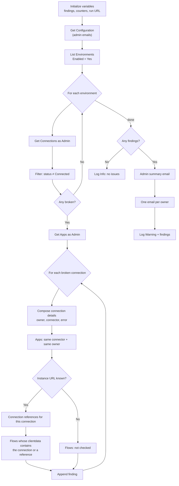
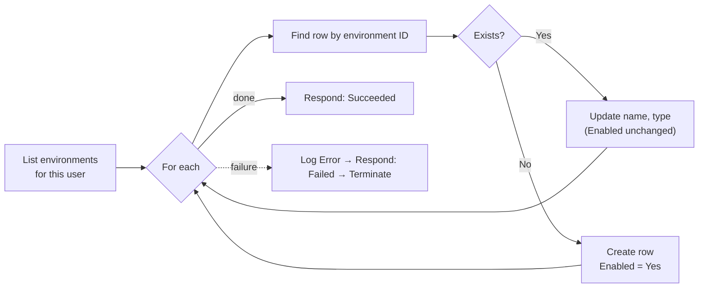

# Flows

## PPMF | Connections | Detect Broken Connections

| | |
|---|---|
| **Trigger** | Recurrence, daily |
| **Connectors** | Microsoft Dataverse, Power Apps for Admins, Office 365 Outlook |
| **Reads** | `ppmf_config`, `ppmf_environments` (Enabled = Yes), each environment's `workflows` and `connectionreferences` |
| **Writes** | `ppmf_logs`; emails to owners and admins |

### Logic

### What counts as "broken"

A connection is reported when its first status entry is anything other than `Connected`
(for example `Error` with codes such as `Unauthenticated`, `ConnectionAuthorizationFailed`
or `ConnectionNotFound`). Connections with no status entry are ignored.

### Error handling

| Failure | Result |
|---|---|
| A whole environment can't be scanned | Error row logged; scan continues; admin summary reports the count |
| App lookup fails | Warning row; findings show "App lookup failed - see Logs" |
| Flow lookup fails | Warning row; findings show "Flow lookup failed - see Logs" |
| One owner email fails | Warning row; other owners still notified |
| Anything else fails | Catch scope: Error row, failure alert to admins, run ends as Failed |

## PPMF | Inventory Flow

| | |
|---|---|
| **Trigger** | Power Apps (V2), called by the configuration app |
| **Connectors** | Power Platform for Admins V2, Microsoft Dataverse |
| **Returns** | `status` (`Succeeded`/`Failed`) and `message` to the app |

## PPMF | Logger Flow

A child flow intended to let other flows and apps write a log row with one call.

> **Status:** the current version's **Add a new row** step does not map its inputs to
> columns, so it creates empty rows. The monitoring flows therefore write to
> **PPMF | Logs** directly. Fixing the mapping is on the [roadmap](roadmap.md).

## Roadmap placeholders

These flows are included with a trigger and no logic yet:

- `PPMF | Application Users | Monitor Credential Expiration`
- `PPMF | Service Accounts | Monitor Password Expiration`
- `PPMF | Flows | Monitor Production Failures`
- `PPMF | Solutions | Monitor Deletion Events`
- `PPMF | Setup | Initialize Framework`

They are switched on but do nothing harmful. You may turn them off until they are implemented.
